# flask_Practice - CI/CD with Jenkins and GitHub Actions

This is my fork of [mohanDevOps-arch/flask_Practice](https://github.com/mohanDevOps-arch/flask_Practice), a Flask + MongoDB student registration app. It contains two CI/CD pipelines:

1. **Jenkins** - Build, Test and Deploy to **staging** on every push to `main`, with email notifications.
2. **GitHub Actions** - Install, Test, Build, Deploy to **staging** (push to `staging` branch) and to **production** (release tag `v*`).

Everything runs in AWS account `099739121791`, region `ap-south-1`. The original README is in [docs/ORIGINAL_README.md](docs/ORIGINAL_README.md).

> The AWS servers were deleted after testing. The screenshots were taken while everything was running.

---

## How it fits together

```
                 push to main                                       deploy (SSM)
Developer ──> GitHub ──webhook──> Jenkins (EC2) ── Build ─ Test ─ Deploy ─────────────> STAGING  EC2 (app + MongoDB)
                 │                     └── SNS email: SUCCESS / FAILED
                 │
                 └──> GitHub Actions ── Install ─ Test ─ Build ─┬─ branch staging ─────> STAGING  EC2
                                                                └─ tag v1.0.0 ────────> PRODUCTION EC2
```

**How a deploy works (both pipelines):**

1. The pipeline packs the commit into `release.tar.gz` and uploads it to the private S3 bucket `flask-deploy-099739121791`.
2. It sends an **AWS SSM Run Command** to the target server. No SSH port is open on any server.
3. On the server, [deploy/remote-deploy.sh](deploy/remote-deploy.sh) unpacks the release, builds the Docker image ([Dockerfile](Dockerfile), gunicorn, non-root user), and starts the app + MongoDB with [deploy/docker-compose.yml](deploy/docker-compose.yml). The last 5 releases are kept for rollback.
4. The script waits for `/health` (app + database) to answer, and the pipeline checks the public URL again.

| Environment | Server | Deployed by |
|---|---|---|
| staging | EC2 `flask-staging` (t3.micro) | Jenkins (push to `main`) and GitHub Actions (push to `staging`) |
| production | EC2 `flask-production` (t3.micro) | GitHub Actions (release tag `v*`) |

## Changes to the application

| Change | Why |
|---|---|
| `/health` route + `test_health` | lets the pipelines check that the app and MongoDB work after a deploy |
| Use the certifi CA file only for TLS connections | the original code always passed `tlsCAFile`, which turns TLS on. That works with MongoDB Atlas but every test failed against a normal MongoDB with `SSL handshake failed` |
| `Dockerfile`, `.dockerignore` | production image with gunicorn instead of the Flask debug server, runs as non-root |
| `deploy/` | compose file, deploy script, server setup script |

## Prerequisites

- AWS account + AWS CLI, GitHub account + GitHub CLI (`gh`)
- A fork of the original repository
- MongoDB is **not** needed on your machine: the pipelines start a MongoDB container for the tests, and each server runs its own MongoDB container

---

# Part 1 - Jenkins pipeline

## 1. Setup

Jenkins runs on an EC2 instance (t3.medium, Amazon Linux 2023):

- [jenkins/ec2-user-data.sh](jenkins/ec2-user-data.sh) installs Docker, clones this repository and starts Jenkins in a container.
- [jenkins/Dockerfile](jenkins/Dockerfile) adds **Python 3, venv and pip**, the Docker CLI and the AWS CLI to the official Jenkins image.
- [jenkins/plugins.txt](jenkins/plugins.txt): pipeline, git, github, junit, configuration-as-code, job-dsl, timestamper.
- [jenkins/casc.yaml](jenkins/casc.yaml) (**Configuration as Code**) creates the admin user and the `flask-practice-ci-cd` pipeline job. No setup wizard, no clicking.
- The admin password is stored in **SSM Parameter Store** (SecureString) and read when the server starts.
- The server has an **IAM role** (no access keys): upload to the deploy bucket, run SSM commands on the **staging** server only, publish to the SNS topic.
- Security group: port 8080 only from my IP and from GitHub's webhook IP ranges.

## 2. Source code

The job clones `https://github.com/rajeshnegd939/flask_Practice.git` (branch `main`) into the Jenkins workspace and uses the [Jenkinsfile](Jenkinsfile) from the repo root.

## 3. Pipeline stages ([Jenkinsfile](Jenkinsfile))

| Stage | What happens |
|---|---|
| **Checkout** | gets the commit; the short commit id is the version |
| **Build** | creates a virtualenv and runs `pip install -r requirements.txt` |
| **Test** | starts a throwaway `mongo:7.0` container, runs `pytest -v --junitxml=reports/junit.xml`; Jenkins shows the test report |
| **Deploy to staging** | only if the tests passed and the branch is `main`: upload release to S3, SSM command to the staging server, then check `http://<staging>/health` |
| **post** | email through SNS: SUCCESS or FAILED |

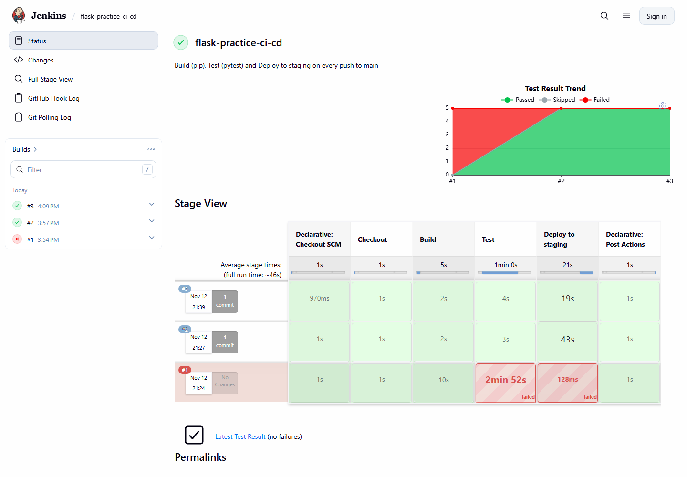
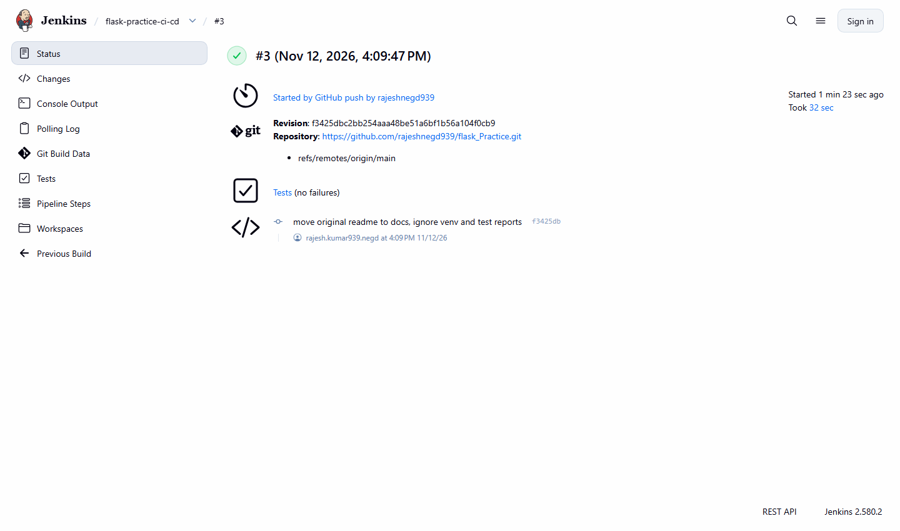
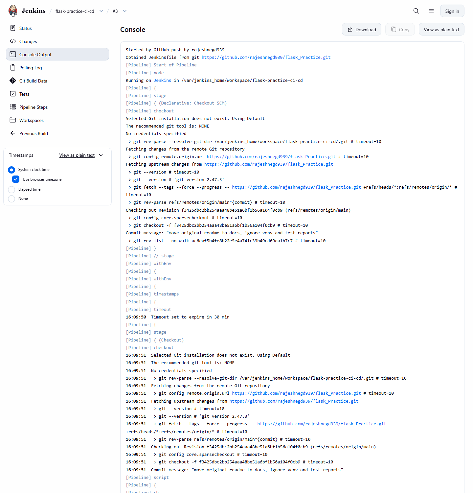
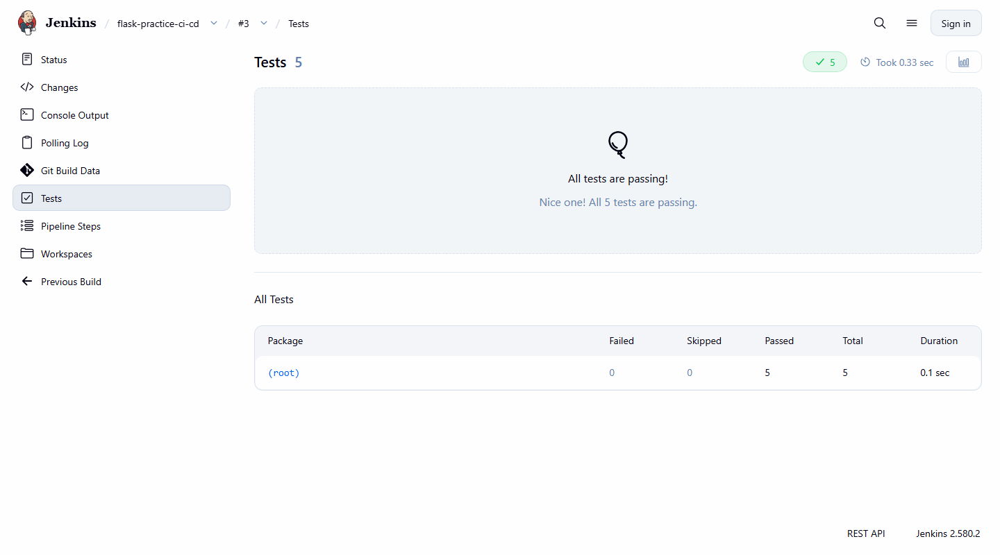
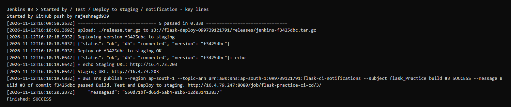

Build #1 ran on a commit before the TLS fix, so the Test stage failed, the deploy was skipped and a FAILED email was sent:

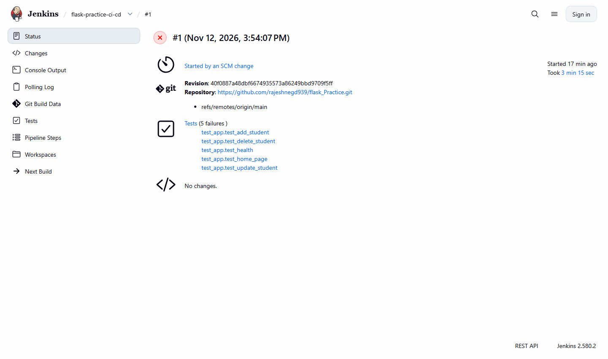

## 4. Trigger on push to main

- A **GitHub webhook** (`push` events) calls `http://<jenkins>:8080/github-webhook/`. The job has the `githubPush()` trigger.
- As a backup the job also polls GitHub every 5 minutes (`pollSCM`).
- Build #3 started **13 seconds** after a push: "Started by GitHub push by rajeshnegd939" (see the console screenshot).

## 5. Email notifications

The `post` section publishes to the **Amazon SNS** topic `flask-ci-notifications`. My email is subscribed to the topic, so every build sends a mail with the result, commit and a link to the build:

- `flask_Practice build #3 SUCCESS` - passed Build, Test and Deploy to staging
- `flask_Practice build #1 FAILED` - with a link to the console log

## How to set it up from scratch

1. Create the IAM role (S3 put, SSM send-command on the staging server, SNS publish, SSM get-parameter), the SNS topic + email subscription and the admin password in SSM (`/flask-practice/jenkins/admin-password`).
2. Launch an EC2 instance with `jenkins/ec2-user-data.sh` as user data, the IAM role, and IMDSv2 hop limit 2 (so the Jenkins container can use the role).
3. Open `http://<ip>:8080`, the job `flask-practice-ci-cd` is already there.
4. In GitHub: Settings → Webhooks → `http://<ip>:8080/github-webhook/`, content type `application/json`, event `push`.

---

# Part 2 - GitHub Actions

## 1. Branches

- `main` - development, runs install/test/build
- `staging` - every push deploys to the staging server
- tags `v*` (for example `v1.0.0`, created with a GitHub Release) - deploy to production

## 2. Workflow files

- [.github/workflows/ci-cd.yml](.github/workflows/ci-cd.yml) - the main workflow
- [.github/workflows/deploy.yml](.github/workflows/deploy.yml) - reusable deploy workflow, used by both staging and production so the steps are not duplicated

## 3. Jobs

| Job | Runs when | What it does |
|---|---|---|
| Install dependencies | every push / PR | `pip install -r requirements.txt` (pip cache) |
| Run tests | after install | `pytest` against a `mongo:7.0` service container, test report uploaded as an artifact |
| Build | tests passed | builds the Docker image to check it, packs the release (`release.tar.gz`) as an artifact |
| Deploy to staging | push to `staging` | `deploy.yml` with environment `staging` |
| Deploy to production | push of a tag `v*` | `deploy.yml` with environment `production` |

The deploy job: download the release → add `SECRET_KEY` from the environment secret → log in to AWS with **OIDC** → upload to S3 → SSM command on the server → smoke test (`/health` and the home page).

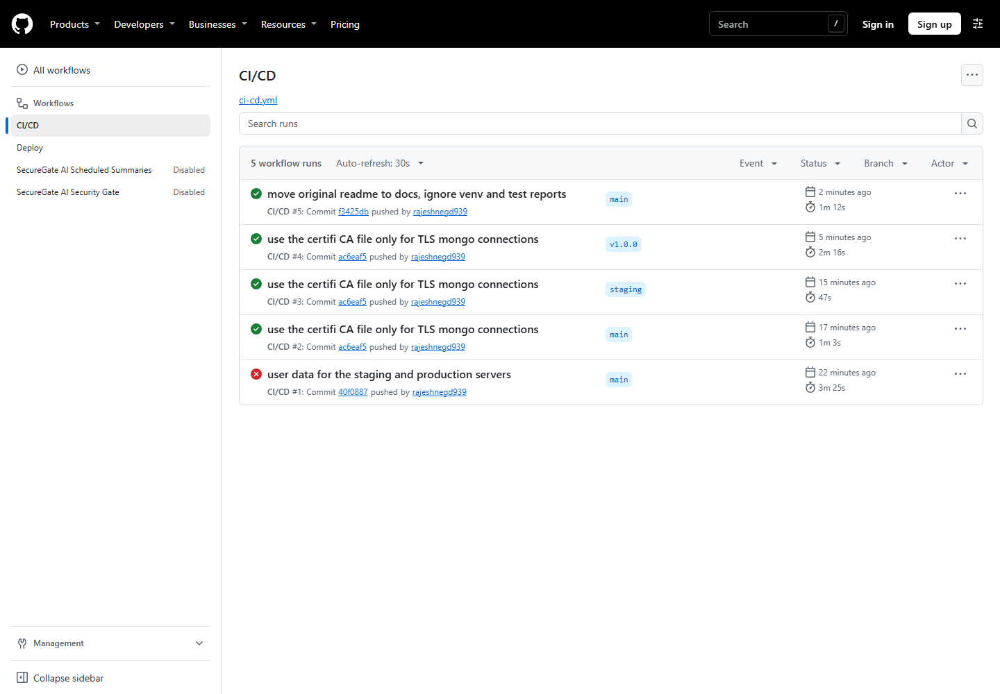
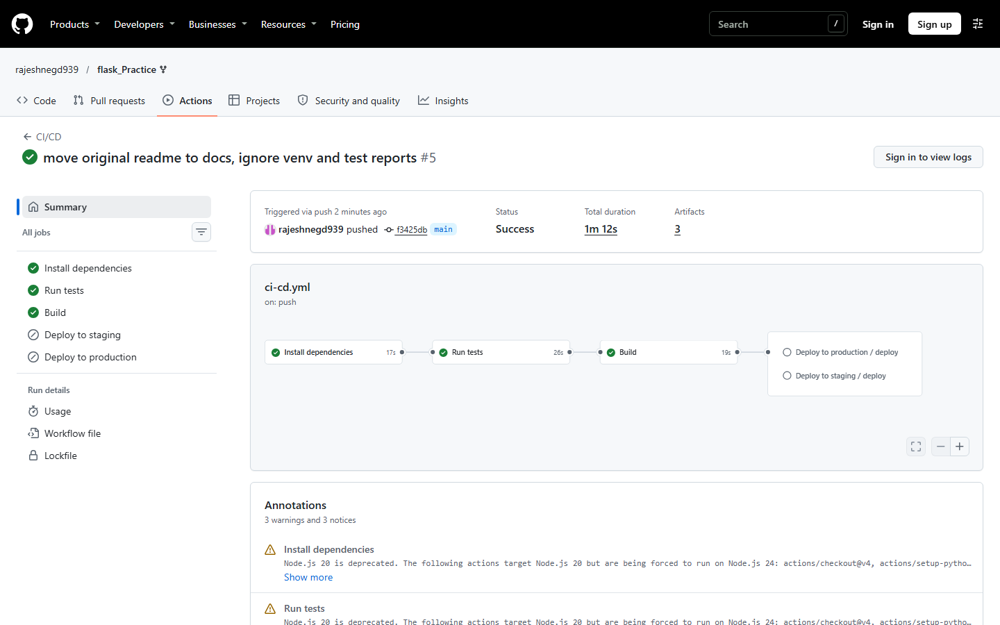
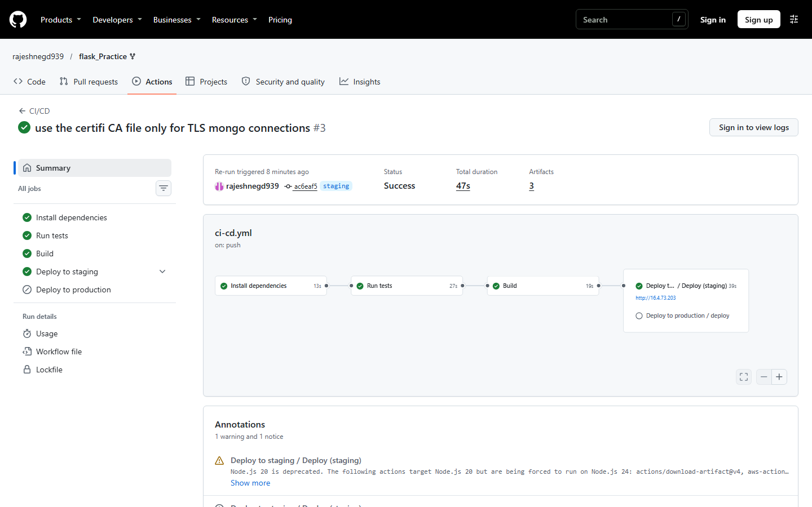
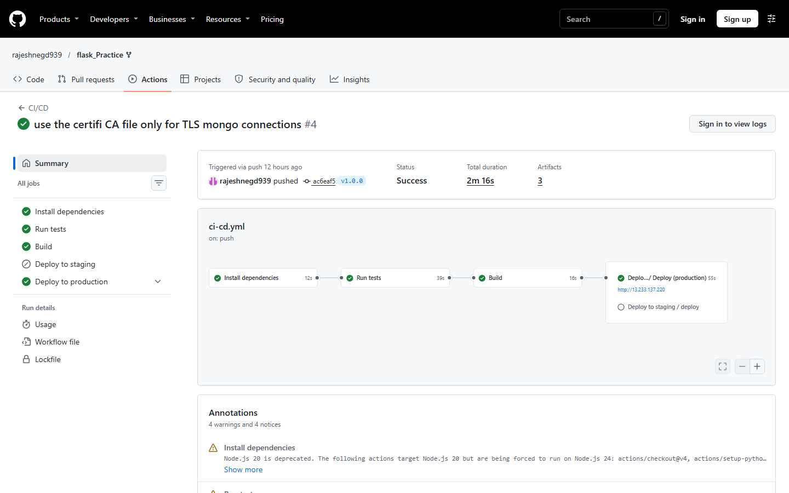
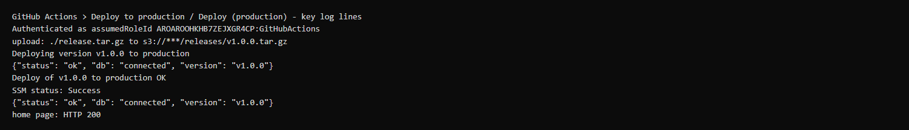
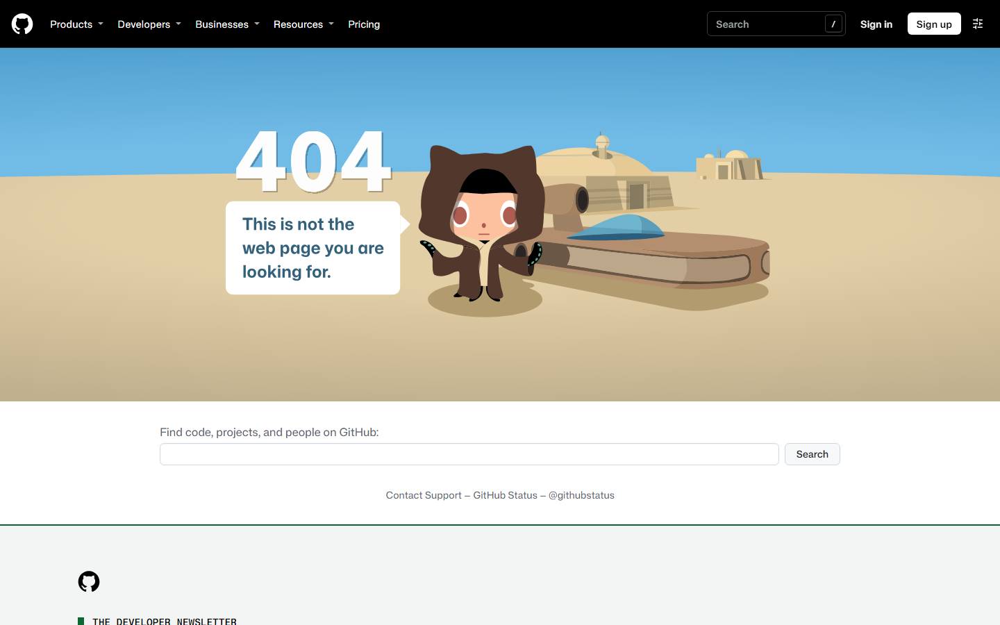
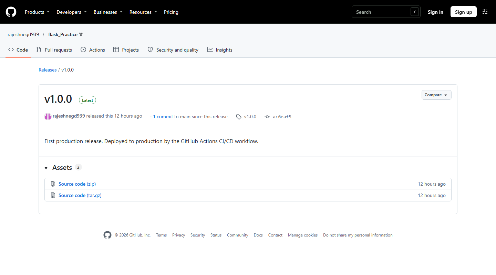

## 4. Secrets

No AWS access keys are stored in GitHub. The workflow gets short-lived AWS credentials through **GitHub OIDC**. The IAM role `flask-gha-deploy-role` trusts only this repository's `staging` and `production` environments.

| Name | Type | Scope | Used for |
|---|---|---|---|
| `AWS_ROLE_ARN` | secret | repository | role the workflow assumes with OIDC |
| `DEPLOY_BUCKET` | secret | repository | S3 bucket for release bundles |
| `INSTANCE_ID` | secret | environment `staging` / `production` | EC2 instance to deploy to |
| `APP_SECRET_KEY` | secret | environment `staging` / `production` | Flask `SECRET_KEY`, different per environment |
| `APP_URL` | variable | environment `staging` / `production` | URL for the smoke test and the environment link |

**How to configure them**

In GitHub: Settings → Environments → New environment (`staging`, `production`) → add the environment secrets and the variable. Repository secrets: Settings → Secrets and variables → Actions → New repository secret.

Or with the GitHub CLI:

```bash
gh api -X PUT repos/<owner>/flask_Practice/environments/staging
gh secret set AWS_ROLE_ARN  --body "arn:aws:iam::<account>:role/flask-gha-deploy-role"
gh secret set DEPLOY_BUCKET --body "flask-deploy-<account>"
gh secret set INSTANCE_ID    --env staging --body "i-..."
gh secret set APP_SECRET_KEY --env staging --body "<random string>"
gh variable set APP_URL      --env staging --body "http://<staging ip>"
# same for production
```

The OIDC trust policy has to use the subject that GitHub sends. GitHub now includes the owner and repository IDs:
`repo:rajeshnegd939@254614628/flask_Practice@1455488004:environment:staging`

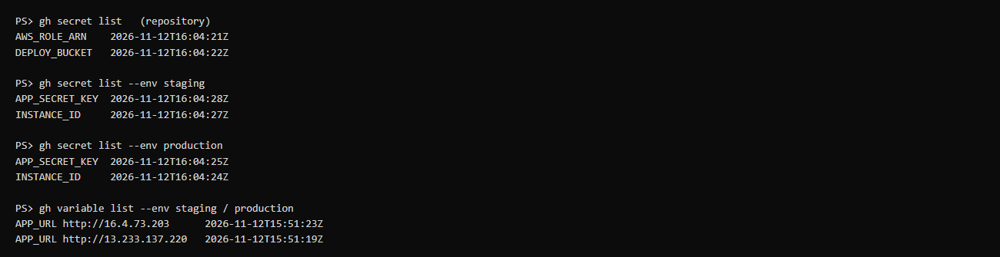
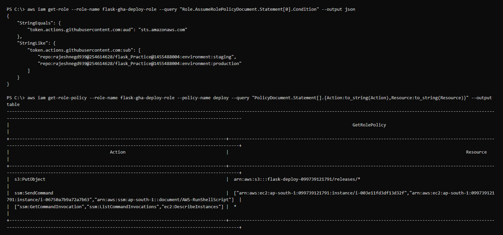

## 5. Release to production

```bash
git tag -a v1.0.0 -m "First release"
git push origin v1.0.0
gh release create v1.0.0 --verify-tag --title v1.0.0
```

---

## The app on the servers

Staging and production, with their own MongoDB:


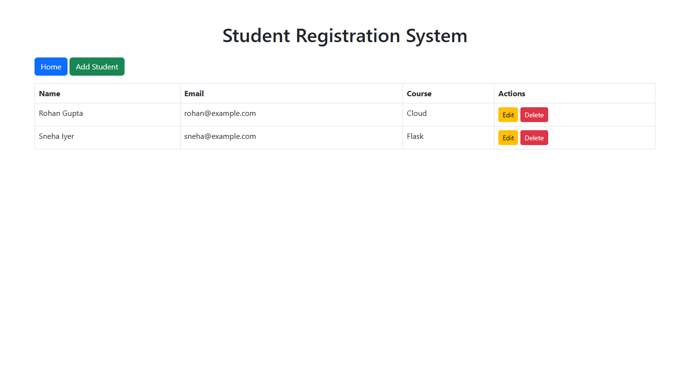
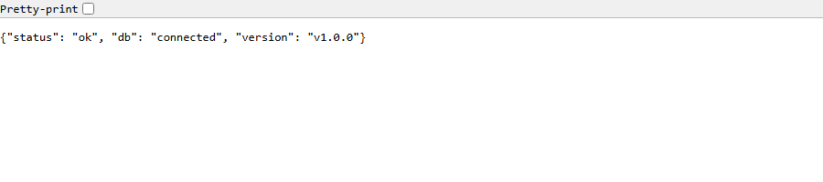

## Security notes

- No SSH on any server; deploys use SSM. App servers only open port 80.
- No long-lived AWS keys in Jenkins or GitHub: EC2 instance role and GitHub OIDC.
- Jenkins can deploy only to staging; only GitHub Actions on a release tag can deploy to production.
- `SECRET_KEY` comes from GitHub environment secrets (or is generated once on the server) and is stored in a `0600` file outside the release folder.
- MongoDB is not exposed outside the Docker network.
- The original repo's `start_flask.sh` contains a hard-coded MongoDB Atlas connection string with a password. It is not used here. The original owner should rotate it.
- The original **SecureGate** security-scan workflows are kept in the repo but **disabled on this fork**, because they need the original owner's secrets (SonarQube, SecureGate API) and would fail on every push.

## Problems I faced

1. **All tests failed with `SSL handshake failed`.** The app always passed `tlsCAFile`, which turns TLS on. Fixed so it is used only for `mongodb+srv://` / `tls=true` URIs.
2. **GitHub Actions could not assume the AWS role.** CloudTrail showed that GitHub's OIDC subject now contains owner and repo IDs (`repo:owner@id/repo@id:...`). Updated the trust policy to that exact value.
3. **`Invalid bucket name`.** I had set the secrets by piping text in PowerShell, which adds a newline at the end. Set them again with `gh secret set --body`.
4. **Jenkins build #1 failed** because it built the commit before the TLS fix. Build #2 and #3 passed.

## Cleanup

All AWS resources (3 EC2 instances, S3 bucket, SNS topic, IAM roles, OIDC provider, security groups, SSM parameter) were deleted after testing.
